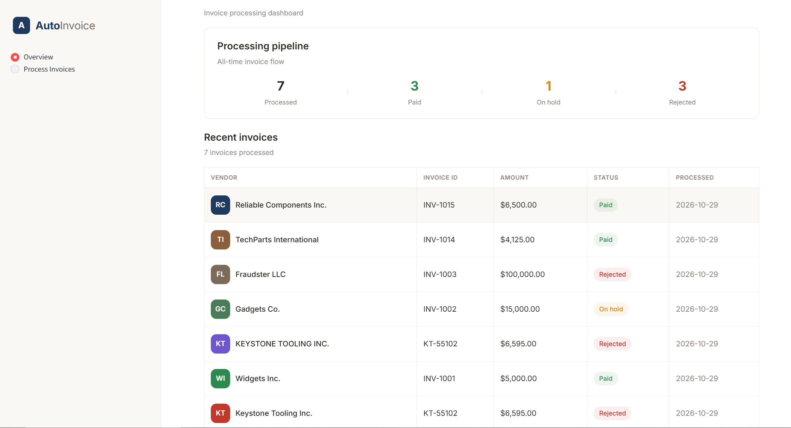

# Galatiq Invoice Processing Pipeline

A multi-agent system that automates end-to-end invoice processing from raw document ingestion through validation, approval, and payment using **xAI's Grok** as the reasoning engine and **LangGraph** for orchestration.

## Architecture

```
                          ┌──────────────────────────────┐
                          │      LangGraph Workflow       │
                          └──────────────────────────────┘
                                       │
    ┌──────────┐   ┌──────────┐   ┌─────────────┐   ┌──────────┐
    │ Ingestion│──>│Validation│──>│  Approval   │──>│ Payment  │
    │  Agent   │<──│  Agent   │   │    Agent    │   │  Agent   │
    │          │   │          │   │ (Tool Use)  │   │          │
    │• Parse   │   │• Check DB│   │• Investigate│   │• Pay     │
    │• Extract │   │• Flag    │   │• Decide     │   │• Reject  │
    │• Struct  │   │• Risk    │   │• Reflect    │   │• Hold    │
    └──────────┘   └──────────┘   └─────────────┘   └──────────┘
         ↑               │
         └───────────────┘
         Self-correction loop
```
## Business Impact

This system addresses Acme Corp's $2M/year problem:

- **30% error rate to near-zero**: LLM extraction handles messy formats; deterministic validation catches mismatches programmatically; self-correction loop fixes OCR/extraction errors
- **5-day delays to seconds**: End-to-end processing in seconds per invoice, with auto-approval for clean low-value invoices
- **Frustrated stakeholders to transparency**: Full audit trail with timestamped reasoning at every stage, available in both CLI and dashboard
- **Fraud risk to proactive detection**: Multi-signal fraud assessment by LLM, with deterministic safety net for duplicate payments and unknown vendors
- **Compliance**: Three-way matching (PO, receipt, invoice), three-tier approval thresholds, CFO sign-off for high-value invoices, all decisions persisted to database


### Agent Details

| Agent | Role | LLM Use | Tools |
|-------|------|---------|-------|
| **Ingestion** | Extract structured data from raw invoices (TXT, JSON, CSV, PDF, XML, scanned images) | Structured output with Pydantic schema; multimodal vision for scanned docs | File parsers, base64 image encoding |
| **Validation** | Verify vendor, items, pricing, arithmetic against ERP database; assess risk | Deterministic code checks + LLM structured risk assessment | Direct DB calls: `lookup_vendor`, `check_item`, `check_duplicate`, `get_fx_rate`, `get_all_items` |
| **Approval** | Three-tier approval ($10K auto / $10K-$50K VP / $50K+ CFO) with tool-use investigation and reflection loop | Three-phase: LLM-driven tool investigation (ReAct loop with `bind_tools`) + VP structured decision + senior auditor reflection | `lookup_vendor`, `get_vendor_history` (bound as LangChain tools), rule engine, safety overrides |
| **Payment** | Process approved invoices, hold flagged ones, reject bad ones; record to DB | None (deterministic) | Payment recording, duplicate tracking |

### Key Design Decisions

1. **Deterministic validation with LLM risk scoring** — The validation agent runs deterministic code checks (vendor lookup, inventory matching, arithmetic verification, pricing deviation detection, fraud keyword scanning, duplicate detection) against the ERP database. Results are passed to the LLM for a structured risk assessment. This keeps validation fast, reliable, and auditable, every check is programmatic and reproducible.

2. **Self-correction loop** — If validation finds items that look like misspellings of known inventory items, the workflow loops back to ingestion with targeted feedback. Max 2 retries to prevent infinite loops.

3. **Three-phase approval with tool use** — The approval agent runs three phases. First, the LLM autonomously investigates the invoice using bound ERP tools (`lookup_vendor`, `get_vendor_history`) via LangChain's `bind_tools` in a ReAct-style loop. The VP independently verifies vendor status and checks for patterns in past invoices. Second, the LLM makes a structured approval decision informed by both the investigation and validation results. Third, a senior auditor LLM critiques the decision (reflection loop). Tool use is in the approval agent rather than validation because vendor due diligence is a subjective business judgment, not a deterministic check.

4. **Safety overrides on deterministic facts only** — Code overrides LLM approvals only for provably wrong decisions: duplicate invoices (reject) and unknown vendors (hold). Fraud signals and risk scores are LLM judgment and are never auto-overridden. This prevents both false-positive rejections and false-negative approvals.

5. **Three-tier approval** — Invoices under $10K with clean validation auto-approve (no LLM needed). $10K-$50K get VP-level LLM review with reflection. Over $50K always require CFO co-approval regardless of LLM decision.

6. **Three-way matching** — Stock mismatches (requested qty > available stock) are treated as legitimate concerns, not informational footnotes. They're flagged as data issues and the LLM factors them into risk scoring, reflecting real-world accounts payable practices.

7. **Multimodal support** — Scanned PDFs with no extractable text are rendered to images and sent inline as base64-encoded PNGs to vision-capable LLMs (xAI Grok, OpenAI). Falls back gracefully on text-only providers.

8. **Provider-agnostic LLM config** — Swap between Grok, OpenAI, Groq, or any OpenAI-compatible API via environment variables. No code changes needed.

## Quick Start

```bash
# 1. Clone and enter the repo
git clone https://github.com/darashizuka/acme_invoice_system.git
cd acme_invoice_system

# 2. Create virtual environment
python -m venv venv
source venv/bin/activate       # Linux/Mac
source venv/Scripts/activate   # Windows (Git Bash)
.\venv\Scripts\activate        # powershell

# 3. Install dependencies
pip install -r requirements.txt

# 4. Configure LLM provider (create .env from template)
cp .env.example .env
# Edit .env and just add your grok API key (see Provider Setup below)

# 5. Initialize inventory database
python setup_db.py

# 6. Process a single invoice
python main.py --invoice_path=data/invoices/invoice_1001.txt

# 7. Batch process all invoices
python main.py --batch=data/invoices --out=results.jsonl

# 8. Launch the Streamlit dashboard
streamlit run app.py
```

### Provider Setup

The system works with any OpenAI-compatible API. Configure in `.env`:

```bash
# xAI Grok (main reasoning engine of this system)
XAI_API_KEY=your_xai_api_key_here

# OR Groq (free tier for testing)
GROQ_API_KEY=your_groq_api_key_here

# OR OpenAI
OPENAI_API_KEY=your_openai_api_key_here

# OR any OpenAI-compatible provider
LLM_BASE_URL=https://api.x.ai/v1
LLM_API_KEY=your_key
LLM_MODEL=grok-4.7
```

## CLI Usage

```bash
# Single invoice
python main.py --invoice_path=data/invoices/invoice_1001.txt

# Batch mode (quick test with a folder containing 2 invoices)
python main.py --batch=invoices3

# Export results as JSON Lines
python main.py --batch=invoices3 --out=results.jsonl

# Verbose logging
python main.py --invoice_path=data/invoices/invoice_1003.txt --verbose

# Custom database path
python main.py --batch=invoices3 --db=acme_erp.db
```

## Streamlit Dashboard

```bash
streamlit run app.py
```



Features:
- **Multi-file upload** — upload one or more invoices, process all with a progress bar
- **Pipeline visualization** — color-coded stage progress (green/blue/gray/red)
- **Summary metrics** — approved/rejected/held/error counts when processing multiple files
- **Detailed results** — extraction confidence, vendor checks, inventory checks, fraud signals, approval reasoning with reflection
- **Export** — download results as JSON Lines
- **Multimodal Support** — Scanned PDFs and images (PNG, JPG) are handled without OCR dependencies. This works with vision-capable models (xAI Grok, OpenAI GPT-4o). On text-only providers (Groq), scanned PDFs will fail gracefully with a clear error.

## Test Scenarios Covered

The system handles all edge cases (expanded test cases in invoices2 folder):

| Scenario | Invoices | Expected Behavior |
|----------|----------|-------------------|
| Clean, within stock | 1001, 1004, 1006, 1011, 1015 | Approved and paid |
| Quantity exceeds stock | 1002, 1005, 1007, 1013 | Flagged as data issue, factors into risk |
| Fraudulent / zero-stock | 1003 (FakeItem, Fraudster LLC) | Rejected — fraud signals |
| Unknown items | 1008 (SuperGizmo), 1016 (WidgetC) | Flagged as not in inventory |
| Data integrity | 1009 (negative qty, empty vendor) | Rejected — data issues |
| OCR errors / typos | 1002, 1012 (O/0 swaps, misspellings) | Corrected via self-correction loop |
| Foreign currency | 1014 (EUR) | USD conversion via FX rates table |
| High-value (>$10K) | 1002, 1003, 1005, 1007, 1013 | VP-level LLM review |
| CFO threshold (>$50K) | 3004 | VP review + always held with `cfo_required` flag |
| Duplicate / revised | 1004 + 1004_revised | Both processed independently |
| Inactive vendor | 3001 (Sunset Supplies LLC) | Rejected — vendor inactive |
| Hold vendor | 3002 (Pending Partners Inc.) | Held — vendor on hold |
| Arithmetic error | 3003 (total doesn't match lines) | Held — arithmetic mismatch flagged |
| Missing fields | 3005 (no vendor, no invoice #) | Rejected — required fields missing |
| Price deviation | 3006 (>10% off reference price) | Flagged as data issue, LLM factors into risk |
| Zero quantity / negative price | 3007 | Rejected — invalid line items |

## Project Structure

```
├── main.py              # CLI entry point with Rich output
├── app.py               # Streamlit dashboard (AutoInvoice)
├── config.py            # LLM provider configuration (multi-provider)
├── setup_db.py          # SQLite ERP database setup (vendors, items, inventory, FX, payments)
├── requirements.txt     # Python dependencies
├── .env.example         # Environment variable template
├── agents/
│   ├── ingestion.py     # LLM-based data extraction (text + multimodal vision)
│   ├── validation.py    # Deterministic ERP checks + LLM risk assessment
│   ├── approval.py      # Three-tier approval with tool-use investigation + reflection loop
│   └── payment.py       # Payment processing with DB recording
├── graph/
│   └── workflow.py      # LangGraph StateGraph with self-correction loop
├── models/
│   └── schemas.py       # Pydantic data models
├── tools/
│   ├── parsers.py       # Multi-format file parsers (TXT, JSON, CSV, PDF, XML, images)
│   ├── inventory_db.py  # ERP database operations (vendors, items, payments, FX)
│   └── payment_api.py   # Mock payment API with ledger
├── tests/
│   ├── test_parsers.py      # Parser unit tests
│   ├── test_inventory_db.py # Database operation tests
│   ├── test_validation.py   # Validation logic tests
│   ├── test_approval.py     # Safety override tests
│   ├── test_pipeline.py     # Mock pipeline integration tests
│   └── test_golden.py       # Golden integration tests (requires LLM API)
├── data/
│   └── invoices/        # Sample invoices (TXT, JSON, CSV, PDF, XML)
└── invoices2/           # All test invoices
└── invoices3/           # quick batch mode test 
```

## Tech Stack

| Component | Technology | Why |
|-----------|-----------|-----|
| **LLM** | xAI Grok (via OpenAI SDK) | Galatiq's core reasoning engine; OpenAI-compatible for easy swaps |
| **Orchestration** | LangGraph | Stateful workflows with cycles (self-correction), conditional routing |
| **Structured Output** | Pydantic + LangChain | Type-safe extraction, validation at the schema level |
| **Database** | SQLite | Simple, file-based, no setup required |
| **CLI** | Rich | Beautiful terminal output with panels, tables, color coding |
| **UI** | Streamlit | Rapid dashboard development, interactive, built-in data display |
| **PDF Parsing** | pdfplumber | Reliable text + table extraction from PDFs |

## Testing

### Deterministic Tests (no API key needed)

```bash
python -m pytest tests/ --ignore=tests/test_golden.py -q
```

**69 tests** across 5 test files, covering:

- **`test_parsers.py`** — File format parsing (TXT, JSON, CSV, XML, PDF text extraction, image base64 encoding), edge cases (empty files, unknown formats)
- **`test_inventory_db.py`** — Vendor lookup with fuzzy matching, item checks, duplicate detection, payment recording, FX rate lookups, invoice number normalization
- **`test_validation.py`** — Arithmetic validation ($0.01 tolerance), pricing deviation detection, data integrity checks (missing fields, negative quantities), fraud keyword scanning
- **`test_approval.py`** — Safety override logic: proves high risk score does NOT trigger override, fraud signals do NOT trigger override, only duplicates and unknown vendors do. Tests both `_should_override` and `_apply_override`.
- **`test_pipeline.py`** — 12 full pipeline tests with mocked LLM: clean invoice, stock mismatch, unknown item, self-correction loop, fraud detection, duplicate blocking, foreign currency, inactive vendor, hold vendor, arithmetic error

### Golden Integration Tests (requires API key added in env)

```bash
python -m pytest tests/test_golden.py -q
```

**35 integration tests** that run real invoices through the full pipeline with a live LLM. These assert deterministic outcomes (decision, payment status, flags) while allowing LLM-generated text to vary. Covers all 16 scenarios in the test scenarios table plus multi-format variants (PDF, CSV, XML of the same invoice).

## Database

The system uses a single SQLite database (`acme_erp.db`) with 6 tables:

| Table | Purpose |
|-------|---------|
| `vendors` | Vendor master — 14 vendors with status (active/hold/inactive), currency, payment terms |
| `items` | Item master — reference prices for three-way matching |
| `inventory` | Warehouse stock levels for stock mismatch detection |
| `payments` | Payment ledger — records all paid invoices for duplicate prevention |
| `processed_invoices` | Audit log — every processed invoice with decision and timestamp |
| `fx_rates` | Foreign exchange rates for multi-currency USD conversion |

All decisions persist across runs. The Streamlit dashboard reads from `processed_invoices` to show a live overview of all processed invoices with their status.

## Multimodal Support

Scanned PDFs and images (PNG, JPG) are handled without OCR dependencies:

1. **PDF with text** — `pdfplumber` extracts text directly (fast, deterministic)
2. **Scanned PDF (no text)** — `pypdfium2` renders each page to an image, encodes as base64 PNG, sends inline to the LLM as a vision message
3. **Image files** — Pillow reads the image, encodes as base64 PNG, same vision pipeline

This works with vision-capable models (xAI Grok, OpenAI GPT-4o). On text-only providers (Groq), scanned PDFs will fail gracefully with a clear error.

